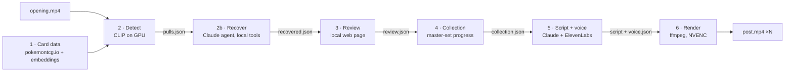

# pokepipe

[](https://github.com/cshipleygit/pokepipe/actions/workflows/ci.yml)
[](LICENSE)


**Turn a raw Pokémon TCG pack-opening video into narrated, edited vertical shorts,
locally, for under $1 per video.**

pokepipe watches the footage, recognises every card on a local GPU, sends a Claude agent
to look for any card detection missed, lets you confirm the results in a small review
page, tracks your master-set progress and what your pulls are worth, writes and voices a
script that a critic checks against the facts and the footage before it's kept,
and renders 1080×1920 posts: the box opening and each pack's tear as quick cuts with
their real sound, packs that run card to card, zooms that follow the card, price tags
and sound effects on the hits, and a rocket-themed master-set progress bar.

<!-- Demo: add a GIF/MP4 here rendered from your own footage, e.g. docs/demo.gif -->

## How it works



| Stage | What it does |
|---|---|
| **1 · Card data** | Fetches any set's checklist and hi-res scans, and builds a CLIP embedding index on the GPU. |
| **2 · Detect** | Samples frames, scores a grid of card-shaped crops per frame in one batched GPU pass, groups confident votes into reveals and reveals into packs, and infers reverse holos from pack slot order. Then finds the moments worth editing around: the box opening, each pack's tear (by sound), where its cards start (the basic Energy) and hits being sleeved. |
| **2b · Recover** | A Claude agent (LangGraph tool loop) works through every pack that came up short. It rescans the gaps on the GPU and uses the pack's slot order to settle near-ties, then suggests the missing cards for review. Only scores and names reach the model, never frames. |
| **3 · Review** | Local page (FastAPI, vanilla JS) to keep, reject or correct each pull, with the video jumping to every card. The only manual step. |
| **4 · Collection** | Master-set tracking (every printing), marking which pulls are new and the progress after each pack, plus what each pull is worth (TCGplayer market price per printing) as the input for profit/loss. |
| **5 · Script + voice** | You choose which packs form each post. Claude writes a script from computed facts only, with a hook and viewer prompts. A critic checks every draft for timing against the footage, spoilers, wrong facts and style, and sends failing drafts back for a rewrite. ElevenLabs voices it with per-word timings. |
| **6 · Render** | Vertical cuts paced by the narration: quick clips of the box and every tear with their own sound, packs card to card with fumbles cut, zooms that track the card, sleeving clips and an end recap. Word-by-word captions, price tags, synthesised sound effects and a progress bar, with each spoken line on its card. |
| **7 · Watch folder** | Drop a video in and it runs end to end, pausing only for your review. Resumable, with failures recorded and retryable. Two engines: a small state machine (default), or a LangGraph state graph with SQLite checkpoints and review as an `interrupt()` (`--engine graph`). |

## Results

Measured on one 10.6-minute 1080p60 opening of 12 packs of *151* (120 cards):

| | |
|---|---|
| Cards found | **120 / 120** (12 packs × 10), 0 false positives |
| Detection time | **89 s** on an RTX 3060 |
| Reverse holos inferred from pack order | 22, verified against the pack layout |
| 45-second post | rendered in **39 s**, all 9 voice lines within 0.1 s of their card |
| API cost | about **$0.20 per 45 s post** (script ≈ $0.04, voice ≈ $0.16) |

And on a creator's own footage: a 16-minute vertical 4K HDR iPhone opening of a
*Delta Reign* Elite Trainer Box (9 packs, 90 cards):

| | |
|---|---|
| Cards found | **86 / 90**; the 4 misses are understood (near-identical art, a borderline frame, a reverse-holo copy merged as a repeat) |
| Missed cards recovered by the agent | **3 / 3** of those the reviewer had to add by hand, **0** wrong suggestions; 5 turns, **$0.13** |
| Decode | 0.9× → **6.6× real time** with NVDEC; whole video about 4 min including CLIP |
| Moments found automatically | 9/9 pack tears and Energy starts, 4/4 box shots, 3/3 sleeved hits |
| Output | two 90 s posts; in-pack jump cuts 27 → 3 and 39 → 1, every voice line on its card |

*Two videos are not a benchmark. Thresholds were calibrated on this footage, and other
cameras, rooms and lighting may need recalibrating (see [Limitations](#limitations)).*

## Engineering notes

The decisions that mattered, each backed by a measurement:

- **Match the whole card, not CLIP's centre crop.** OpenCLIP's default preprocessing
  crops cards to their middle square, dropping the name bar and attack text. Squashing
  the whole card (references and frame crops alike) took a synthetic benchmark from
  87.9% to 92.8% top-1, and real-video recall from 114 to 120 cards.
- **Batched GPU cropping.** Each frame becomes up to 30 candidate crops via a single
  `torchvision.ops.roi_align` call, so frames never leave the GPU. Exact cosine search
  over a few hundred cards needs no ANN library.
- **Thresholds from data.** Per-frame scores were dumped and plotted. Genuine reveals
  peak at 0.80–0.89 cosine, while sealed product, hands and code cards stay below 0.71.
  The segmenter's thresholds sit in that gap.
- **Domain knowledge beats pixels for reverse holos.** CLIP can't see a reverse-holo
  pattern (same card, same art), but unshuffled packs follow a fixed slot order. A
  conservative layout matcher marks slots 8–9 and refuses to guess on shuffled packs.
- **OCR evaluated, not adopted (yet).** Reading the set code and number from the
  card's corner got 97/120 right and ran 5× slower than CLIP. It's planned as a set
  detector and tie-breaker rather than the main identifier.
- **Grounded LLM output.** The script model (`claude-opus-5-5`, structured output via
  Pydantic) sees only computed facts. Every line must anchor to a real pull id, so it
  can't invent cards, and stage 6 can time each line to its reveal.
- **Narration-driven pacing.** The edit is cut into regions at each card a line is
  about. Quiet regions speed up, talky ones slow down (never below 1×), and the
  scriptwriter is told each card's screen time in advance. That took a test post from
  58 s with a 7 s freeze to 45.2 s with every line on its card.
- **Cost guardrails.** Every paid call is logged, a pre-call budget check refuses to
  exceed $1 per video, and TTS audio is cached by content hash so re-renders are free.
- **Human-in-the-loop as data.** Detection output is never edited. Review decisions are
  stored separately, so the pair forms labelled data for recalibration.
- **Sound finds the tears.** Zero-shot CLIP prompts ("tearing a booster pack") fired on
  almost every frame, because the opener's display of boxes sits behind every shot.
  High-passed audio didn't: tearing foil is -25 to -40 dB in an otherwise quiet room.
  The last crinkle before each pack's basic Energy is its tear and then the cards coming
  out, and that Energy (already in the index as a decoy) is where its cards start.
- **Cut on recognition, not margins.** Padding each card's shot by a few tenths of a
  second was exactly when the next card's edge peeked out. Shots now start and end where
  each card is recognised; the slide between two cards plays through in about 0.12 s,
  and only real fumbles are cut.
- **Zooms that track the card.** Detection boxes are grid cells, too rough to frame a
  card. During each zoom the known card is re-found 5×/s by a coarse-to-fine box search
  against its own embedding (preferring the largest near-best box, since CLIP rates the
  artwork alone about as high as the whole card), then smoothed and widened wherever the
  card would be clipped.
- **Agent for the gaps, not the whole job.** CLIP finds most cards. A Claude agent
  only looks at packs that came up short, using local tools: a pack overview, a GPU
  rescan of a window with loose thresholds, and a check of whether a candidate fits the
  pack's slot order. On *Delta Reign* that settled an Uncommon-vs-Illustration-Rare
  near-tie (lead 0.009) and found a reverse-holo copy that had been merged as a repeat.
  The turn limit is an edge in the graph, the budget is checked before every call, and
  every suggestion still goes through human review.
- **Writer ⇄ critic for scripts.** Free deterministic checks (timing against each
  card's screen time, spoilers, pack numbers, cards not in the post, wrong rarities,
  "new" vs "duplicate" claims) plus an optional style-guide judge. A failing draft goes
  back with every problem listed, up to two rewrites, and the best attempt is kept. Run
  over the scripts already on disk (`narrate critique`), the checks found 7 of 8 earlier
  drafts broke at least one rule.
- **LangGraph where it earns its place.** The watch pipeline can run as a state graph:
  a SQLite checkpointer (one thread per video) resumes a crash or failed stage at the
  node that didn't finish, and review is a real `interrupt()` resumed with
  `Command(resume=True)`. Both engines share the same idempotent stage functions and
  `job.json` status view.
- **Nothing to license.** Sound effects are synthesised with numpy, and the rocket is
  drawn with Pillow.

## Quick start

Requires Python 3.12, [ffmpeg](https://ffmpeg.org/) on `PATH` (with libass), and an
NVIDIA GPU for detection. Tested on Windows 11 with an RTX 3060.

```bash
git clone https://github.com/cshipleygit/pokepipe && cd pokepipe
python -m venv .venv
.venv\Scripts\activate                      # macOS/Linux: source .venv/bin/activate
pip install torch torchvision --index-url https://download.pytorch.org/whl/cu128
pip install -e ".[dev]"
copy .env.example .env                      # then add your API keys
```

Keys: `ANTHROPIC_API_KEY` (script), `ELEVENLABS_API_KEY` + `ELEVENLABS_VOICE_ID`
(voice). Detection, review and collection tracking need no keys.

## Usage

**The easy way: a watch folder.** Start it once and leave it running:

```bash
pokepipe watch run          # watcher + review page at http://127.0.0.1:8765
```

Drop a video into `data/inbox/<set_id>/` (e.g. `data/inbox/sv3pt5/`). It's taken in
once it finishes copying, and card data is fetched if the set is new. Detection and
moment-finding then run and the job waits for you. On the review page, confirm the
cards and, on **Finish**, choose which packs go into each post. Collection, valuation,
scripts, voice and render then run on their own; any hit without a price is logged so
you can add it to `data/prices/<set_id>.csv` (see below). `pokepipe watch status` shows where every video is;
`pokepipe watch retry <slug>` resumes a failed one.

`pokepipe watch run --engine graph` runs the same pipeline as a LangGraph graph
(checkpoints in `data/graph/`), with the missed-card agent before review.

**Or stage by stage:**

```bash
# 1. Card data for the set you opened (once per set)
pokepipe cards sets --search "151"
pokepipe cards fetch sv3pt5 && pokepipe cards embed sv3pt5

# 2. Detect pulls, then the box / tear / Energy / sleeving moments for the series edit
pokepipe detect run opening.mp4 --set sv3pt5
pokepipe detect moments <video-slug>
pokepipe recover run <video-slug>          # optional: agent looks for missed cards

# 3. Review in the browser (http://127.0.0.1:8765)
pokepipe review serve

# 4. Update your collection, and price the pulls (→ values.json, for P/L)
pokepipe collection apply <video-slug>
pokepipe collection status sv3pt5
pokepipe collection value <video-slug>

# 5. Plan posts, write and voice the scripts
pokepipe narrate plan <video-slug> --posts "1-3, 9, 10-12" --seconds 45
pokepipe narrate script <video-slug>        # writer ⇄ critic; posts/<n>/critique.json
pokepipe narrate voice <video-slug>

# 6. Render
pokepipe render post <video-slug>          # → data/videos/<slug>/posts/<n>/post.mp4
```

Every stage reads and writes JSON under `data/`, so any step can be re-run or
inspected on its own. Run `pokepipe <stage> --help` for all options.

**Measuring the AI parts:** `pokepipe recover eval <slug>` scores the agent's
suggestions against the cards you added by hand in a finished review, and
`pokepipe narrate critique <slug> --all` runs the script checks over every script on
disk (no API calls). `SCRIPT_CRITIC=false` turns the critic off.

**Prices.** Market prices come from pokemontcg.io (TCGplayer) once it has them; a
brand-new set can take a few weeks. Until then, or to use your own numbers, list them in
`data/prices/<set_id>.csv` with columns `card_id,variant,usd,source,as_of` (variant is
`normal`, `holo` or `reverse`). The sheet wins over the API.

**Make it yours:** edit [`config/style.md`](config/style.md) (the narration style
guide), choose a voice with `pokepipe narrate voices`, and optionally drop a branded
intro at `config/intro.mp4`. `render post --no-narration` renders the edit alone, with
the source audio and no API spend.

## Project layout

```
src/pokepipe/
  cards/        stage 1  API client, cache, CLIP embedder, GPU index, price book
  detection/    stage 2  frame sampler, GPU matcher, segmenter, packs, slot layouts,
                         moments (box, tears, Energy starts, sleeving: sound + vision)
  recover/      stage 2b missed-card agent: evidence tools, LangGraph tool loop, eval
  review/       stage 3  FastAPI app, edit rules, static UI
  collection/   stage 4  master-set model, per-video contributions, values (P/L input)
  narration/    stage 5  post planning, Claude scripts, writer ⇄ critic loop, ElevenLabs,
                         budget
  render/       stage 6  edit timeline, pacing, card tracking, zoom paths, captions,
                         rocket theme, sound effects, ffmpeg
  watch/        stage 7  inbox intake, resumable job state machine, watcher loop
  graph/        stage 7  the same pipeline as a checkpointed LangGraph state graph
tests/          pytest; APIs mocked, no GPU needed except tests marked `gpu`
config/         style guide (and optional intro clip)
```

Design notes for each stage, with calibration data, are in [CLAUDE.md](CLAUDE.md).

## Testing

```bash
pytest            # ~200 tests: no network, no GPU (a few render tiny clips with ffmpeg)
pytest -m gpu     # real CLIP model on CUDA
ruff check src tests
```

CI runs the CPU suite and lint on every push.

## Limitations

- **Calibrated on two videos.** Detection thresholds and the moment rules (sound
  levels, sleeve timing) come from two openings, so check `pulls.json` and
  `moments.json` on new footage. Talking, music or a noisy room would break the
  sound-based tear detection.
- **Pack layouts:** slot order is defined for Scarlet & Violet (verified on *151*) and
  Mega Evolution (verified on *Delta Reign*). Shuffled packs get no reverse-holo
  guesses (review handles them).
- **New sets** may lack API price data for a few weeks: printings then come from a
  rarity rule (master-set totals approximate) and prices from your price sheet.
- **Detection needs an NVIDIA GPU.** It can run on CPU, but slowly.

## Roadmap

- Profit/loss: record what each product cost and report value pulled minus cost per
  video and across a series (`values.json` is the input).
- Recovery agent: measure it on more labelled videos (one so far), and give it a
  corner-OCR tool for tie-breaks.
- More agents on the same graph: a price finder that proposes rows for the price sheet
  and waits for approval, and an MCP server exposing collection status to chat clients.
- Creator profiles (style guide, voice, theme, intro, collection per creator).
- Set auto-detection and tie-breaking from the card's corner text (OCR).

## Disclaimer

pokepipe is an unofficial fan project. It is not affiliated with, endorsed by or
sponsored by Nintendo, The Pokémon Company, Creatures or GAME FREAK. Pokémon and card
names are trademarks of their respective owners. Card data and images come from the
[Pokémon TCG API](https://pokemontcg.io) and are cached locally, never redistributed by
this repository. Only render footage you own or have rights to.

## License

[MIT](LICENSE) © 2026 Chance Shipley
